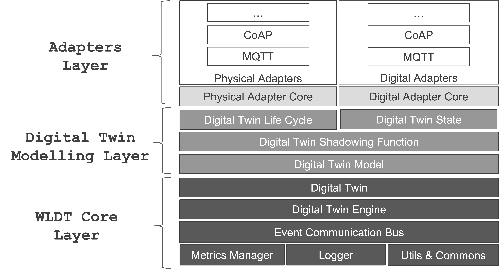

# Library Structure & Basic Concepts

The WLDT framework intends to maximize modularity, re-usability and flexibility in order to effectively mirror
physical smart objects in their digital counterparts.  The proposed library focuses on the simplification of twins
design and development aiming to provide a set of core features and functionalities for the widespread
adoption of Internet of Things DTs applications.

A WLDT instance is a general purpose software entity
implementing all the features and functionalities of a Digital Twin running
in cloud or on the edge. It has the peculiar characteristic
to be generic and ``attachable'' to any physical thing in order to
impersonate and maintain its digital replica and extend the provided functionalities
for example through the support of additional protocols or a specific translation
or normalization for data and formats.

Hereafter, the requirements that led the design and development of the WLDT framework are:
- i) Simplicity - with WLDT developers must have the possibility to easily create a new instance by using
  existing modules or customizing the behavior according the need of their application scenario;
- ii) Extensibility - while WLDT must be as simple and light as possible,
  the API should be also easily extendible in order to let programmers to personalize
  the configuration and/or to add new features loading and executing multiple modules at the same times;
- iii) Portability & Micorservice Readiness - a digital twin implemented through WLDT must
  be able to run on any platform without changes and customization. Our goal is to have a simple and light core engine
  with a strategic set of IoT-oriented features allowing the developer to easily create DT applications modeled
  as independent software agents and packed as microservices.

In the following Figure, the main components that make up the architecture of WLDT are represented,
and thus through which the individual Digital Twin is implemented.
Specifically, from the image it is possible to identify the three levels on which the
architecture is developed: the one related to the ``core`` of the library, the one that ``models`` the DT,
and finally, that of the ``adapters``.

  

Each of this core components has the following main characteristics:

- **Metrics Manager**: Provides the functionalities for managing and tracking various metrics
  within DT instances combining both internal and custom metrics through a flexible and extensible approach.
- **Logger**: Is designed to facilitate efficient and customizable logging within implemented and deployed DTs with
  configurable log levels and versatile output options.
- **Utils & Commons**: Hold a collection of utility classes and common functionalities that can be readily employed
  across DT implementations ranging from handling common data structures to providing helpful tools for string manipulation.
- **Event Communication Bus**: Represents the internal Event Bus, designed to support communication between
  the different components of the DT's instance. It allows defining customized events to model
  both physical and digital input and outputs. Each WLDT's component can publish on the shared Event Bus and define
  an Event Filter to specify which types of events it is interested in managing,
  associating a specific callback to each one to process the different messages.
- **Digital Twin Engine**: Defines the multi-thread engine of the library allowing the execution and monitoring of
  multiple DTs (and their core components) simultaneously. Therefore, it is also responsible for orchestrating
  the different internal modules of the architecture while keeping track of each one, and it can be
  considered the core of the platform itself allowing the execution and control of the deployed DTs. Currently, it supports
  the execution of twins on the same Java process, however the same engine abstraction might be used to extend the framework to
  support distributed execution for example through different processes or microservices.
- **Digital Twin**: Models a modular DT structure built through the combination of core functionalities together with physical
  and digital adapter capabilities. This Layer includes the `Digital Twin State`  responsible to structure the state of the DT by defining the list of properties, events, actions, and relationships.
  The different instances included in the lists can correspond directly to elements of the physical asset
  or can derive from their combination, in any case, it is the `Digital Twin Model` and its management of the **Shadowing Process** that defines
  the mapping, following the model defined by the designer.
  This component also exposes a set of methods to allow SF manipulation.
  Every time the Digital Twin State is modified, the latter generates the corresponding DT's events to notify all the components
  about the variation: a **description** event (the complete new structure, only when the structure really changes) and a **values** event
  (only the values that changed), published on two separate topics of the event bus. The complete state never travels on the bus: every component
  that observes it (Digital Adapters, Storage Manager, Augmentation Function Handlers) keeps its own complete local copy (`DigitalTwinStateReplica`)
  updated at every event. The state is read through its **description** and its **values**; the values can be limited to a set
  of resources by name with a `DigitalTwinStateFilter` (the description is never filtered).
- **Digital Twin Model**: It is the library component responsible for defining the behavior of
  the Digital Twin by interacting with the Digital Twin State.
  Specifically, it implements the shadowing process that allows keeping the
  DT synchronized with its physical entity.
  This component is executed by a specific implementation of a WLDT Worker called `DigitalTwinKernel`,
  as part of the Digital Twin run by the `DigitalTwinEngine`.
  The Digital Twin Model is the fundamental component that must be extended by the DT designer
  to concretize its model.
  The model observes the life cycle of the Digital Twin to be notified of the different state changes.
  For example, it is informed when the DT enters the Bound state, i.e. when its Physical Adapters
  have completed the binding procedure with the physical asset. This component also allows the designer
  to define the behavior of the DT in case a property is modified, an event is triggered, or an action is invoked.
- **Physical Adapter**: It defines the essential functionalities that the individual extensions,
  related to specific protocols, must implement.
  As provided by the DT definition, a DT can be equipped with multiple Physical Adapters
  in order to manage communication with the corresponding physical entity.
  Each will produce a `Physical Asset Description (PAD)`,
  i.e., a description of the properties, events, actions, and relationships
  that the physical asset exposes through the specific protocol.
  The DT transitions from the Unbound to the Bound state when all its Physical Adapters
  have produced their respective PADs.
  The Digital Twin Model
  selects the components of the various PADs that it is interested in managing.
- **Digital Adapter**: It provides the set of callbacks that each specific implementation can use
  to be notified of changes in the DT state (`onStateDescriptionUpdate` for the structure and `onStateValuesUpdate` for the values),
  with the values optionally limited by a `DigitalTwinStateFilter` and a `DigitalTwinStateChangeFilter` (the description is never filtered).
  Symmetrically to what happens with Physical Adapters, a Digital Twin can define
  multiple Digital Adapters to expose its state and functionality through different protocols.
- **Augmentation Functions**: Extend the behaviour of the Digital Twin with stateless (one-shot) or stateful (continuous)
  functions, e.g., for analytics or AI, managed by the Augmentation Manager through its handlers
  (see [Augmentation Functions](augmentation_function.md)).
- **Storage & Query System**: Stores the data about the evolution of the Digital Twin in one or more storages and makes them
  available to Digital Adapters and Augmentation Functions through queries (see [Storage & Query System](storage_query_system.md)).
- **Resources & Management Interface**: Handle the resources of the Digital Twin that can be managed at runtime and expose
  them to external applications (see [Resources & Management Interface](resources_management_interface.md)).

Therefore, to create a Digital Twin using WLDT, it is necessary to define and instantiate a DT with its Digital Twin Model and
at least one Physical Adapter and one Digital Adapter, in order to enable connection with the physical
entity and allow the DT to be used by external applications. Once the 3 components are defined,
the Digital Twin can be added to a `DigitalTwinEngine` that starts its lifecycle.
In the following sections we will go through the fundamental steps to start working with the library and creating all
the basic modules to design, develop and execute our first Java Digital Twin.